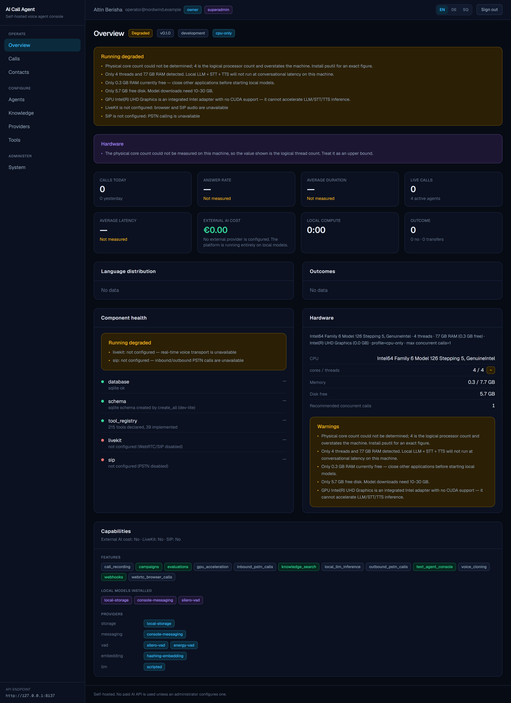
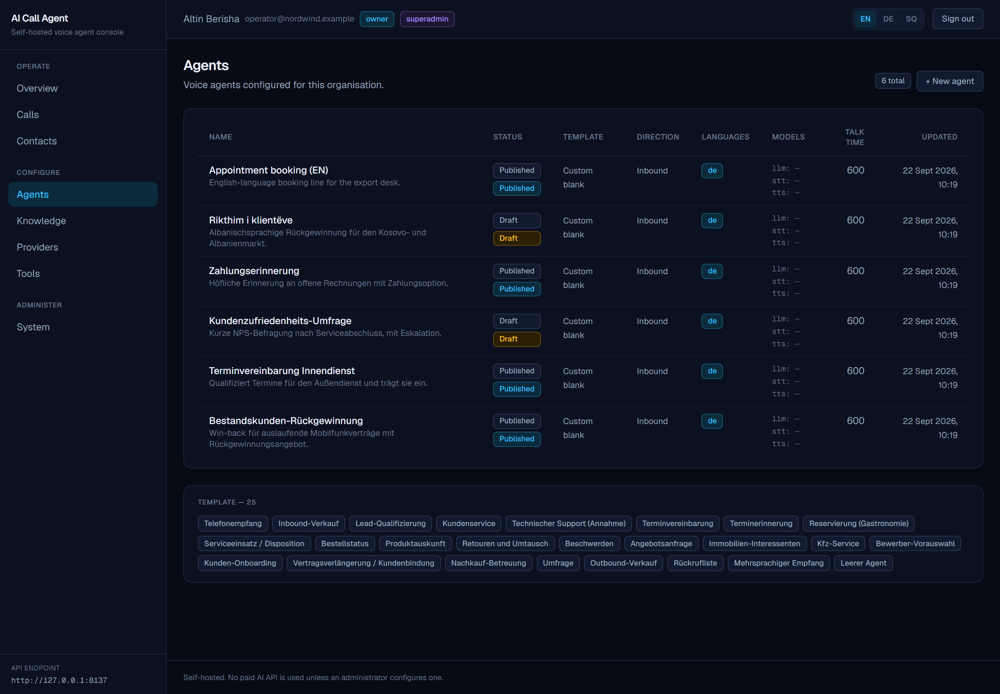
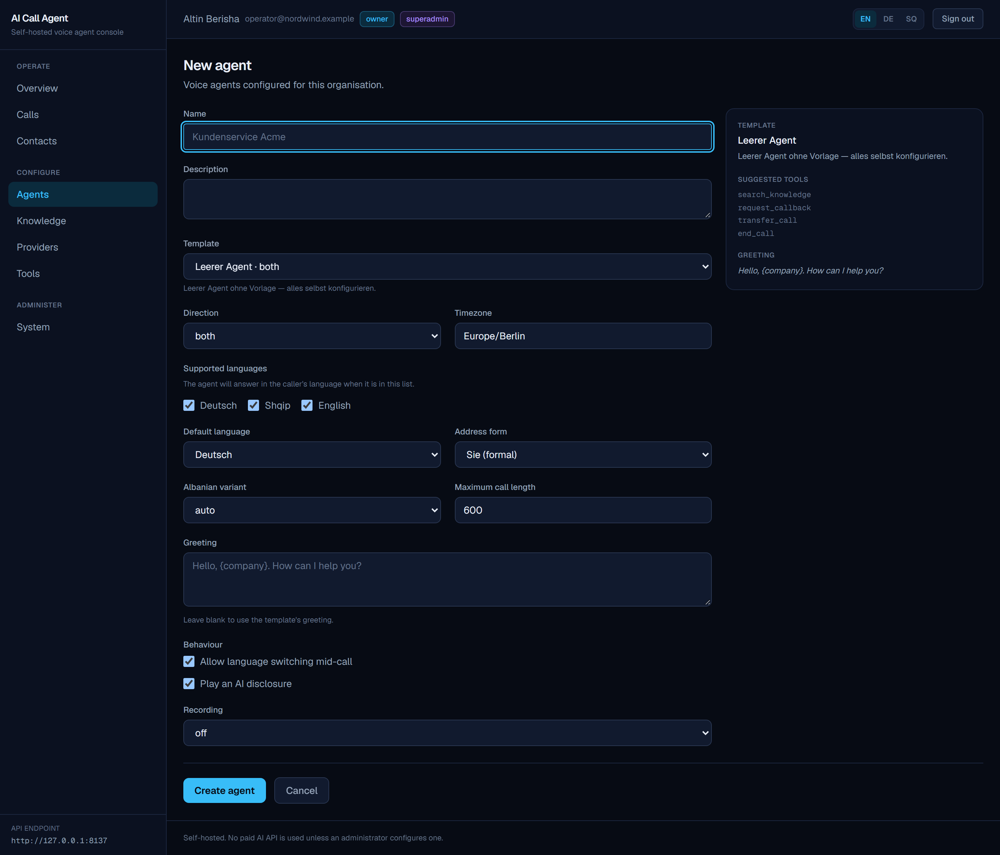
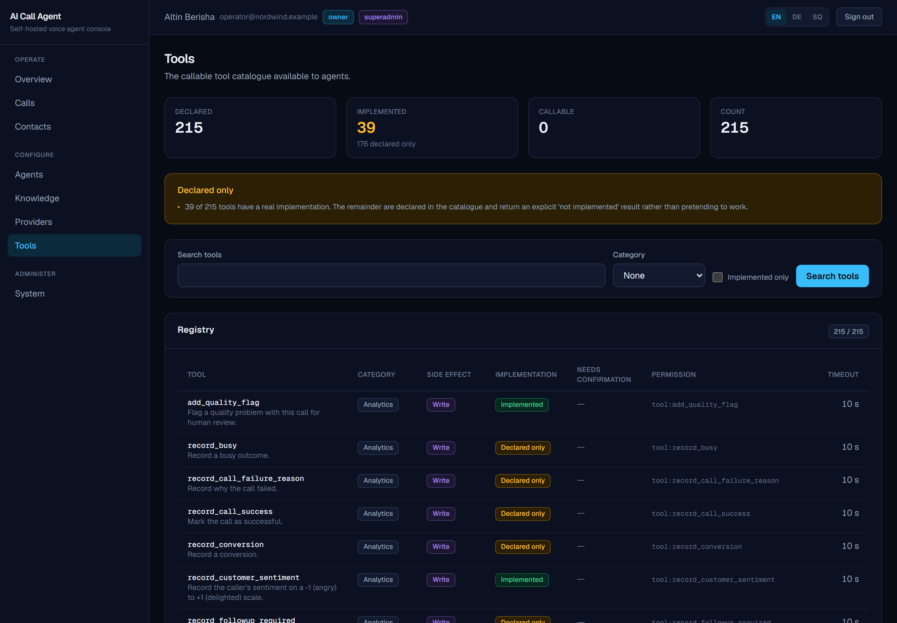
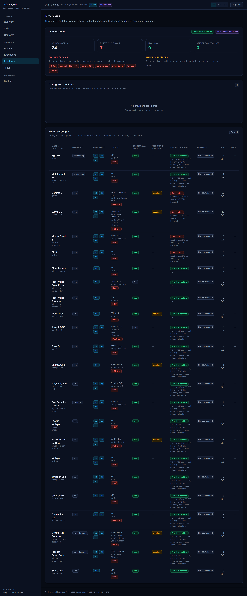
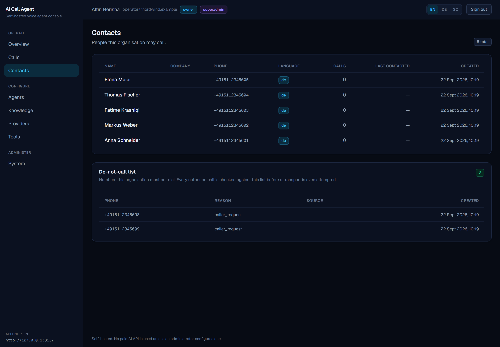
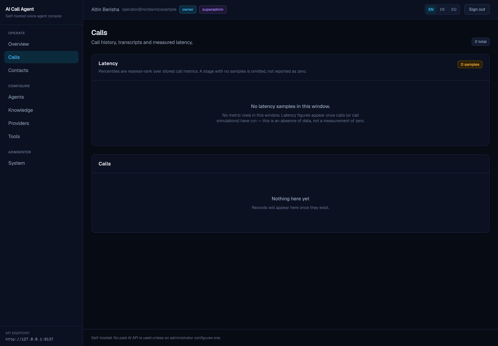
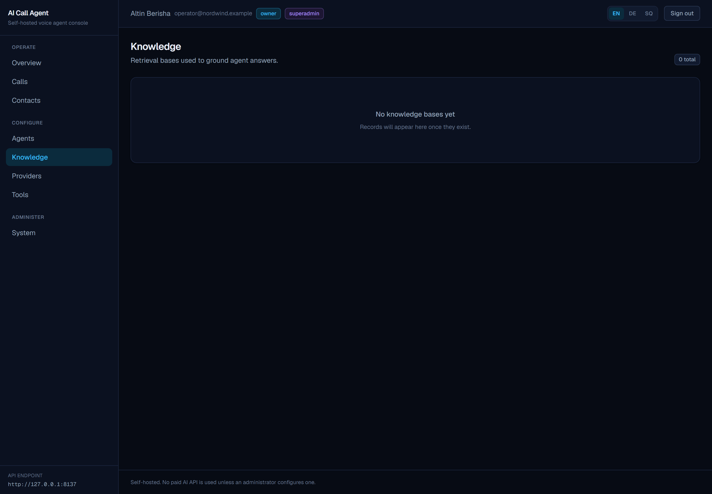
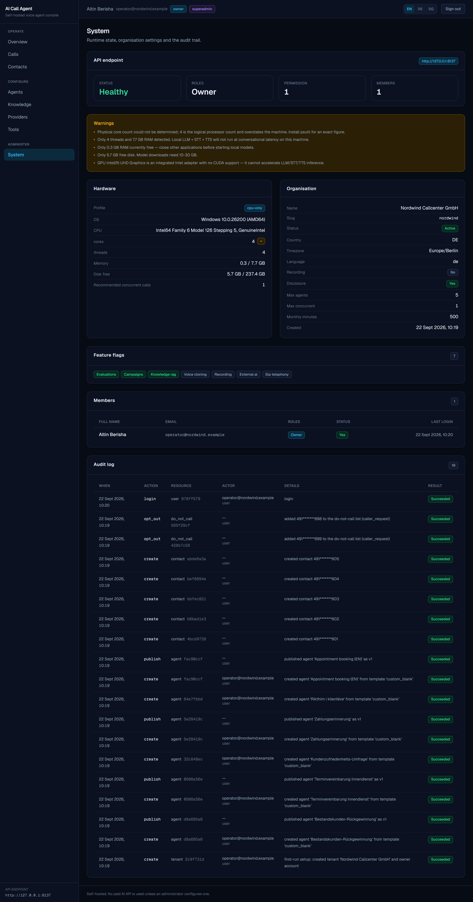
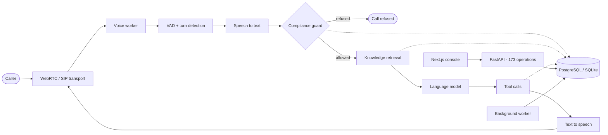

**Altin Kalludra** · [Download CV (PDF)](https://github.com/ulasmango-cmd/atlascall-portfolio/raw/refs/heads/main/cv/Altin-Kalludra-CV.pdf)

<div align="center">

# AI Call Agent

**A self-hosted, multi-tenant, multilingual AI phone-agent platform** — where compliance is enforced in Python before a dial is attempted, never by asking the model for permission.

[](#project-status)
[](#what-is-verified)
[](#ownership)

</div>

> **This repository is a portfolio case study, not a source mirror.** The implementation is private and proprietary. See [Ownership](#ownership).

📸 **[Browse the screenshots](#screenshots)** · 🖥️ **[Open the demo page](https://ulasmango-cmd.github.io/ai-call-agent/)**

---

## The idea

Most "AI receptionist" products ask you to trust a black box. You hand over your phone number, your customer list and your call recordings, and you get a monthly bill and a promise.

This one is built on the opposite premise: **you can audit it.** It runs on your own hardware, it costs nothing per call by default, and — the part that actually matters — every claim it makes about itself is either measurable or explicitly marked as not measured.

The design rule the whole system is organised around:

> If consent, suppression, calling hours or compliance state cannot be verified, **the call is not placed**.

That rule is enforced in the dial path itself, in Python, before a transport is attempted. The language model is never asked whether it is allowed to make the call. A prompt injection cannot talk the system into dialling someone who opted out.

---

## Screenshots

Every image below is a real page from the running application, captured by a scripted browser session against a real API — not a mockup. The harness starts the API on a throwaway database, seeds realistic content **through the public HTTP API**, then signs in through the actual login form with a real browser before capturing. If a page had rendered an error screen or redirected to sign-in, the harness would have failed rather than shipped the image.

### The overview — the honesty posture, made visible

Health reads `degraded` with the exact reasons. Unmeasured metrics read `— Not measured` rather than `0`, because "no data" and "zero" are different facts. LiveKit, WebRTC and SIP all show `not configured`, because they are not.



### Agents

Six agents across German, Albanian and English, showing published versus draft state. Agents are created from a catalogue of 25 use-case templates and move through draft → published with a full version history.



The create form populates greeting and system prompt from the chosen template, and carries per-language support, an Albanian variant selector, and explicit toggles for mid-call language switching and AI disclosure.



### The tool catalogue — the honest ledger

215 tools declared, **39 implemented**, 176 declared only. The panel states plainly that unimplemented tools "return an explicit 'not implemented' result rather than pretending to work".

Most projects would show you the 215.



### Providers and the licence audit

24 known models with their licence and commercial position: 7 permitted, 7 refused, 17 requiring attribution. In commercial mode this is enforced by a CI gate, not asserted in prose.



### Compliance, in the interface

The do-not-call register is a first-class screen, not a settings checkbox. Numbers here are checked before every dial, and the check fails **closed** — if the register cannot be read, the call is refused rather than allowed.



### And the rest

| Calls | Knowledge |
| :---: | :---: |
|  |  |

**System** — runtime state, organisation settings, members, roles and the audit trail. Eight roles, enforced per tenant.



---

## What is verified

Every number here was produced by running code, not by reading it. This is the section a reviewer should attack.

| Metric | Value | How it was measured |
| :--- | :--- | :--- |
| Tests | **146 passed, 0 failed, 0 skipped** | `pytest tests` |
| Verify gate | **PASSED** — licence · lint · types · tests | `python scripts/dev.py verify` |
| Type checking | **clean, 95 source files** | `mypy apps/api/app packages/*` |
| API operations | **173** across **135** paths | `app.openapi()["paths"]` |
| Database tables | **65** | `len(Base.metadata.tables)` |
| Callable tools | **215 registered — 39 implemented, 176 declared** | `registry_stats()` |
| Evaluation scenarios | **40** (20 DE · 10 SQ · 10 EN) | `len(ALL_SCENARIOS)` |
| Console routes | **11**, in EN / DE / SQ | `scripts/verify_dashboard.py` |

---

## What is not built

This section exists because the alternative — a capability list with no gaps in it — would be a lie.

**The voice runtime does not exist.** `apps/voice-worker/` is scaffolded only: a dependency manifest and six 0-byte package stubs. There is no realtime pipeline, no streaming audio, no barge-in handling, no jitter buffer. It has never been run.

**It cannot be built on the development machine.** Measured, not assumed:

```
CPU      Intel Core i3-1005G1 @ 1.20 GHz — 2 physical cores / 4 threads
RAM      7.7 GB total, ~1.6 GB free
GPU      Intel UHD Graphics — integrated, no CUDA, 0 GB VRAM
Profile  CPU_ONLY — below the spec's lowest supported tier
```

LiveKit + Postgres + a local LLM + Whisper + TTS simultaneously on this machine will not produce a conversational response. **This is a hardware limit, not a code-quality limit.**

Also outstanding, and named rather than implied:

- **176 of 215 tools** are declared stubs. The registry, permission gating and argument validation are done and tested; the bodies are not.
- **Telephony is API-only.** Trunks, numbers, routing rules and dial-plan preview are modelled. The SIP gateway config has never been started. There is no SIPp suite.
- **The pgvector/HNSW retrieval path is written but never benchmarked** — no Postgres on the development machine.
- **`ToolInvocation` is never persisted.** Tool calls inside a conversation leave no durable trace.
- **`AgentSession.summary()` is never called**, so the record that AI-disclosure text played is not stored — even though it does play.
- **Email delivery for invites** is not implemented; tokens are returned in the API response.
- **No browser-interaction testing.** Forms are rendered and driven by the capture harness, but there is no visual regression or accessibility audit.
- **Docker images have never been built** on this machine.

> **The most important caveat in this project.** The voice pipeline is where nearly all the remaining risk lives — audio buffering, jitter, barge-in, codec negotiation, latency under load — and **none of it has been tested**. Treat every voice-adjacent claim here as *designed, not demonstrated*.

---

## Technical highlights

**Fail-closed compliance.** DNC, calling hours and consent are evaluated in Python before a dial is attempted. A test pins the ordering: a DNC number must be refused *for being on the DNC list*, not for a missing transport — otherwise compliance would silently depend on infrastructure state.

**Layered end-of-turn detection.** Frame VAD, adaptive pause timing, a semantic/punctuation heuristic and a contextual override. Trailing connectives — *"und"*, *"dhe"*, *"and"* — suppress end-of-utterance even after a pause, so a caller who pauses mid-sentence is not interrupted. The spec explicitly forbade a fixed 2-second timer, and there is not one.

**Untrusted-data wrapping.** Retrieved knowledge is fenced in `<<<UNTRUSTED_DATA>>>` markers and labelled as data, not instructions. A document in the knowledge base cannot issue the agent orders.

**Provider abstraction with licence gating.** Twelve-plus provider interfaces behind a router with fallback chains, health caching and per-model licence enforcement. Swapping a simulated model for a real local runtime is a provider *registration*, not a rewrite. `ProviderLicenceRefused` and `ProviderAuthError` are non-retryable **by design**.

**Honest degradation as a system property.** Simulated providers stamp `simulated: true` on their output. Health reports `degraded` with reasons. Undefined percentiles are `null`, never `0`. A tool that cannot do its job returns `ok=False` and says so out loud.

**A durable worker.** Atomic claim via conditional `UPDATE` (exactly-once, tested), HMAC-signed webhooks, a six-step retry backoff, replay rejection, an SSRF allowlist, retention purge and idempotent periodic rescheduling. Verified by running it twice: the second run created zero duplicates and executed zero jobs.

**A licence gate that has actually failed.** `scripts/licence_gate.py` runs in CI and in the local verify gate. It caught real drift on its first run, and then caught a conceptual error in its own logic where capability rejection had been conflated with licence rejection. A gate that only ever passes is decoration.

---

## Engineering challenges

**Making the system refuse.** It is easy to build a dialler that dials. It is considerably harder to build one that refuses when the legal basis is unclear, and to make that refusal visible and explainable to the operator.

**Finding a class of silent failure.** Tools reach their dependencies through a service registry. In one session it emerged that this registry was empty at every construction site, so `save_opt_out` was telling callers *"I have noted that you do not wish to be contacted again"* while writing nothing — a false statement to a consumer and a GDPR Article 21 failure. An AST audit of all 39 implemented tools found 29 with no I/O and no `simulated` flag; 15 were genuine false-success claims and were rewritten. The lesson is that a success return value is a claim, and claims need testing.

**Discovering the code had never been type-checked.** `mypy` was declared, configured and invoked — but its installed copy was corrupt and it could not run. It had been excluded from the verify gate on sound-sounding reasoning and recorded as an honest gap, which is exactly why nobody noticed. The first clean run found 93 errors and four real bugs, including a `500` on an endpoint that had been broken the whole time. *"We cannot run this check here" is a statement about the environment, not about the code.*

**Fixing a verification gate that was lying.** The local verify gate reported the test step as failing against a run where 146 of 146 tests passed, because the sandbox's bulk-delete guard intercepts pytest's teardown and pollutes its exit code. The fix re-derives the verdict from pytest's own XML report — and then that fix was **negative-tested**, because a checker that cannot fail is decoration. Real failures, a corrupt report and an empty report all still produce `FAIL`.

**Multi-tenant correctness, proven rather than asserted.** A test onboards a *real* second organisation, invites a user, accepts the invitation, logs in as them, and then demonstrates they cannot see the first tenant's data — across eight resource types.

---

## Architecture



The compliance guard sits **before** the model, not after it. The model proposes; Python decides.

| Layer | Stack |
| :--- | :--- |
| **API** | Python 3.13, FastAPI, SQLAlchemy 2.x async, Alembic, Pydantic v2 |
| **Console** | Next.js 16 (App Router), React 19, TypeScript, Tailwind v4, Server Actions |
| **Data** | SQLite in dev, PostgreSQL + pgvector for deployment |
| **Providers** | 12+ interfaces behind a router with fallback chains and licence gating |
| **Quality** | pytest (146), ruff, mypy, a licence gate, and a dashboard harness |
| **Deployment** | Docker Compose with five composable profiles; dev-lite runs with no containers at all |

---

## Deployment profiles

The platform detects its own hardware and adapts. Three shapes are supported, and the one you are on determines what actually runs.

| Profile | Target | What runs |
| :--- | :--- | :--- |
| **dev-lite** | Any laptop | SQLite, text-mode agent loop, simulated providers, the full test suite. No containers. |
| **LOCAL** | 16 GB+ machine | Docker Compose core (Postgres + pgvector) with an optional LiveKit profile. |
| **GPU** | CUDA host | vLLM + faster-whisper + Chatterbox for real local inference. |

Nothing is faked to make a demo look better. Where a component cannot be exercised on the development hardware, the documentation says so and names the exact command a user with the right machine should run.

---

## Project Status

**Backend complete and tested. Voice runtime not built.**

The REST API, the multi-tenancy and role model, the compliance engine, the agent lifecycle, the knowledge pipeline, the background worker, the evaluation suite and the Next.js console are all implemented and covered by tests. The verify gate is green.

The voice path is designed but has never been executed, and the development machine cannot execute it.

---

## Ownership

Built by **Altin Kalludra** ([@ulasmango-cmd](https://github.com/ulasmango-cmd)).

- GitHub profile: [github.com/ulasmango-cmd](https://github.com/ulasmango-cmd)
- Demo page: [ulasmango-cmd.github.io/ai-call-agent](https://ulasmango-cmd.github.io/ai-call-agent/)
- Private production source: [ulasmango-cmd/ai-call-agent-source](https://github.com/ulasmango-cmd/ai-call-agent-source) *(private)*

---

## License

The production implementation is **private and proprietary**. This repository contains portfolio documentation, screenshots and a demo page only — it intentionally does not include application source code, business logic, infrastructure configuration or credentials.

© Altin Kalludra. All rights reserved.
